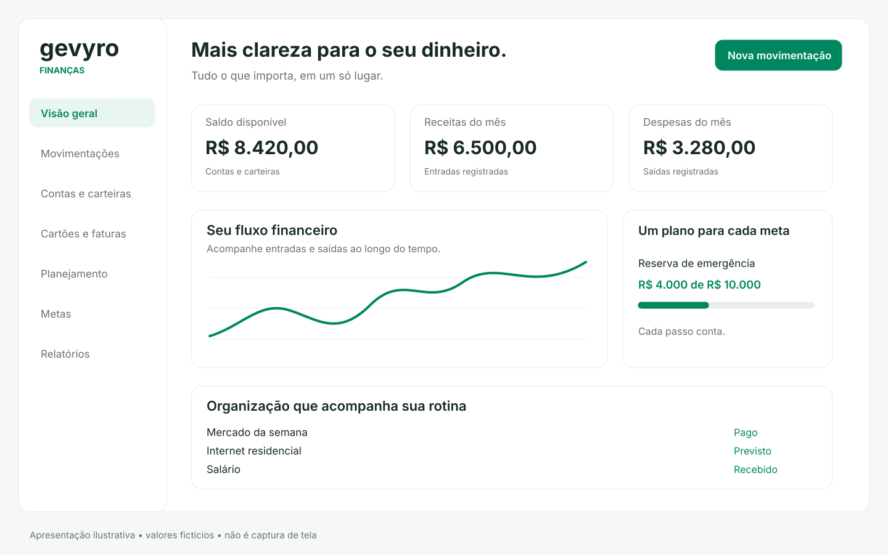
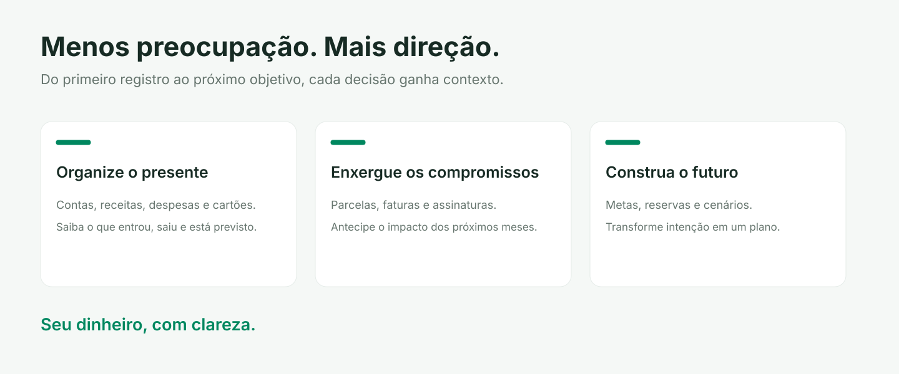
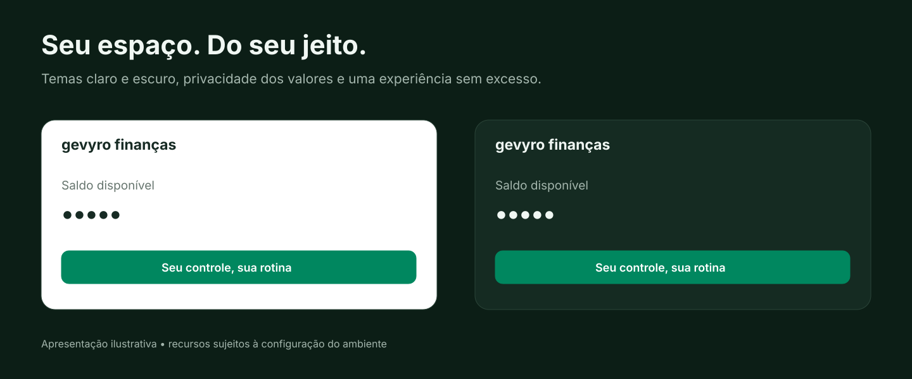

<p align="center">

  
</p>

<h1 align="center">Gevyro Finanças</h1>
<p align="center"><strong>Seu dinheiro, com clareza.</strong></p>
<p align="center">Organize o presente. Entenda seus compromissos. Planeje o que vem pela frente.</p>



> As imagens deste README são apresentações ilustrativas com valores fictícios. O aplicativo começa vazio, pronto para receber os seus registros.

## Faça suas finanças caberem na sua rotina

Contas em lugares diferentes, compras parceladas, assinaturas que passam despercebidas e aquela dúvida sobre quanto realmente está livre para gastar. O Gevyro Finanças reúne essas informações em um espaço simples, organizado e agradável de usar.

Você acompanha seu dinheiro com contexto: o que já aconteceu, o que está comprometido e o que pode mudar nos próximos meses. Sem depender de uma planilha espalhada ou de números que escondem os compromissos futuros.

## Tudo o que importa, em um só lugar

| Para você                | O que o Gevyro ajuda a fazer                                                                          |
| ------------------------ | ----------------------------------------------------------------------------------------------------- |
| Ter clareza no dia a dia | Reunir contas e carteiras, registrar receitas e despesas e acompanhar saldos.                         |
| Cuidar dos cartões       | Organizar compras, parcelas e faturas, com pagamentos integrais ou parciais.                          |
| Evitar surpresas         | Visualizar vencimentos, recorrências e assinaturas, com alertas dentro do aplicativo.                 |
| Dar destino ao dinheiro  | Criar orçamentos por categoria, acompanhar compromissos e reservar para metas.                        |
| Planejar com contexto    | Comparar cenários, observar projeções diárias e entender quando parcelas terminam.                    |
| Acompanhar o patrimônio  | Registrar posições manuais, aportes, resgates, rendimentos recebidos e dívidas.                       |
| Entender seus hábitos    | Consultar relatórios por período, conta e categoria, considerando compras, vencimentos ou pagamentos. |
| Trazer seu histórico     | Revisar importações CSV e OFX antes de confirmar, com identificação de duplicidades.                  |
| Manter uma cópia         | Exportar backups completos e restaurar registros compatíveis.                                         |



## Pequenas decisões, uma visão maior

**Saiba quanto está disponível.** Separe saldo em conta, despesas previstas e reservas das suas metas para tomar decisões com mais informação.

**Entenda o peso das parcelas.** Veja como seus compromissos se distribuem no tempo e como o orçamento muda quando eles terminam.

**Dê atenção às assinaturas.** Acompanhe recorrências e simule a economia de cancelamentos. O controle é financeiro; cancelar um serviço exige falar com o fornecedor.

**Acompanhe cada ajuste.** Registre conciliações, juros, descontos, reembolsos e quitação antecipada com histórico, preservando a origem dos valores.

**Planeje sem confundir estimativa com dinheiro recebido.** Compare projeções conservadoras, padrão e otimistas com premissas identificadas.

## Uma experiência que respeita sua atenção

A identidade esmeralda da Gevyro encontra uma interface limpa, com navegação lateral, cartões organizados e temas claro e escuro. Você também pode ocultar valores na tela e usar atalhos para encontrar registros ou adicionar movimentações.



## Seus dados merecem cuidado

O Gevyro foi adaptado para manter os registros financeiros **somente no Supabase**, com acesso obrigatório pela mesma conta Google em todos os dispositivos. Não há modo financeiro local nem fila de gravações offline.

A interface busca novas informações automaticamente a cada 30 segundos enquanto está visível, e ao retomar o aplicativo. Uma gravação só aparece como concluída depois da confirmação do servidor. Conflitos entre dispositivos são recusados para evitar sobrescrever alterações.

A sessão de autenticação pode permanecer no navegador para manter o acesso. Os registros financeiros são carregados na memória durante o uso, sem serem guardados em um banco local. Backups JSON/CSV só são baixados quando você solicitar.

**A conexão ao Supabase está habilitada, com login Google e isolamento dos dados por usuário.** Entre com a mesma conta em cada dispositivo. A tela financeira exige autenticação e não oferece fallback para gravar no navegador.

Se você usava a versão anterior, é possível recuperar um backup do histórico antigo e migrá-lo explicitamente para uma conta vazia. A cópia anterior só é removida depois de conferir a gravação no Supabase.

## Comece pelo essencial

1. Entre com sua conta Google e cadastre uma conta financeira com saldo de referência.
2. Adicione suas receitas, despesas e compromissos.
3. Organize cartões, categorias, orçamentos e metas conforme sua rotina.
4. Consulte os relatórios e as projeções para decidir os próximos passos.
5. Exporte seu backup regularmente.

O Gevyro é um organizador financeiro pessoal. Cotações, valores patrimoniais e dívidas são informados manualmente; não há conexão bancária automática, recomendação de investimento ou promessa de rentabilidade.

## Estado desta edição

> **Nuvem ativada:** Google habilitado no Supabase, tabelas/RLS/RPCs instalados e verificados, plano Free confirmado pelo proprietário e conexão do aplicativo liberada para o projeto MCell autorizado. Os registros financeiros são gravados somente no Supabase. Menções a etapas pendentes abaixo são registros históricos; consulte o relatório atualizado.

Os fluxos financeiros essenciais estão implementados com persistência exclusiva na nuvem, condicionada à ativação do projeto real. A publicação na Vercel e o login Google no projeto real exigem as conexões administrativas e a validação descritas no [checklist de entrega](docs/CHECKLIST-ENTREGA.md). Os limites funcionais estão na [verificação funcional](docs/VERIFICACAO-FUNCIONAL.md).

Não há assinatura comercial ou checkout de venda ativado nesta edição.

## Para executar o projeto

```bash
npm ci
cp .env.example .env.local
npm run dev
```

Acesse `http://localhost:3000`. Sem a nuvem habilitada, o aplicativo mostra a configuração pendente e não permite novos registros. Para produção, consulte [publicação e login Google](docs/PUBLICACAO.md). Para reportar uma vulnerabilidade, consulte [SECURITY.md](SECURITY.md).

---

<p align="center"><strong>Gevyro Finanças</strong><br />Organização para hoje. Clareza para o que vem depois.</p>

## Mais clareza em cada parcela e investimento

Corrija o vencimento de uma parcela sem mexer nas demais. Antecipe as que fizerem sentido, veja o que já pagou e acompanhe o saldo da compra até a última parcela. Cada correção preserva seu histórico.

Na carteira, organize renda fixa, ações, fundos imobiliários, ETFs, Tesouro, fundos e cripto por ativo e instituição. Registre compras, vendas, aportes e proventos com suas taxas e impostos. O Gevyro separa investimento de consumo e mostra a avaliação que você informou, sem inventar preços.

O dashboard distingue consumo, pagamentos, investimentos, transferências, dívidas e patrimônio. Assim, pagar a fatura não se transforma em uma segunda compra e um aporte não se mistura ao gasto do mês.

[Conheça os controles, as verificações e os limites desta atualização](docs/ATUALIZACAO-CONTROLE-FINANCEIRO.md).
